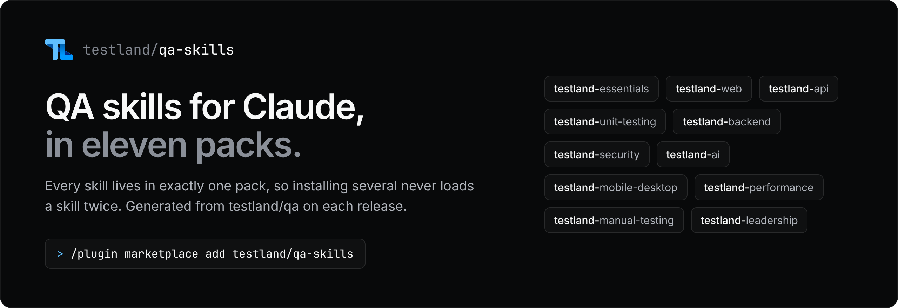

# Testland QA skills

[](LICENSE)
[](#packs)
[](#packs)
[](https://github.com/testland/qa)
[](https://testland.io/plugins)
[](https://cloudback.it)

Skills and agents for software testing and quality engineering, packaged as 11 Claude plugins. Each skill is in exactly one pack, so installing several packs never loads a skill twice.

This repository is generated from [testland/qa](https://github.com/testland/qa) on every release. Please star it there, and see [Contributing](#contributing) to report a problem or change a skill.

## Install

```text
/plugin marketplace add testland/qa-skills
/plugin install testland-essentials@testland-qa-skills
```

## Packs

| Pack | Skills | Agents | What it covers |
| --- | --- | --- | --- |
| [Testland Essentials](testland-essentials/) | 53 | 16 | Core QA workflow for any team: test strategy and planning, test data and environments, test review against conventions, test reports and CI results, CI integration, and flaky-test triage. |
| [Testland Backend](testland-backend/) | 39 | 11 | Testing backend and distributed systems: async jobs and queues, caches, concurrency and race conditions, database migrations, distributed tracing, feature flags and experiments, sagas and CQRS, serverless functions, and time and timezones. |
| [Testland API](testland-api/) | 39 | 8 | Testing APIs and integrations: REST API tests, consumer-driven contracts, GraphQL, gRPC, auth flows (OAuth, OIDC, Keycloak, Auth0, Okta), real-time protocols, email and push notifications, and payment flows. |
| [Testland Security](testland-security/) | 34 | 4 | Security testing and compliance: SAST, DAST, dependency, secret and SBOM scanning, infrastructure-as-code checks, fuzzing, compliance controls, test-data privacy, and multi-tenant isolation tests. |
| [Testland Web](testland-web/) | 37 | 7 | Testing web front ends: browser end-to-end tests, visual regression, accessibility, localization, PDF and print output, browser extensions, and progressive web apps. |
| [Testland Unit Testing](testland-unit-testing/) | 28 | 4 | Unit and code-level testing: unit tests for JavaScript and TypeScript, Python, JVM, .NET, Go and Rust, mutation testing, property-based testing, BDD, and CLI tool tests. |
| [Testland AI](testland-ai/) | 27 | 7 | Testing AI and data systems: LLM evaluation and red-teaming, ML model tests, search relevance, AI-assisted test generation and review, and data quality checks. |
| [Testland Mobile and Desktop](testland-mobile-desktop/) | 26 | 4 | Testing native apps and devices: iOS and Android, desktop apps, embedded and hardware-in-the-loop systems, and games. |
| [Testland Performance](testland-performance/) | 19 | 1 | Performance, resilience and production checks: load testing, chaos and resilience drills, synthetic monitors, canary validation, and release runbooks. |
| [Testland Manual Testing](testland-manual-testing/) | 14 | 8 | Manual and exploratory testing: test design techniques, exploratory charters and sessions, bug reproduction and reports, defect tracking, and test case management. |
| [Testland Leadership](testland-leadership/) | 13 | 3 | Quality leadership and planning: QA team management and reporting, test impact analysis, code-quality gates, and shift-left reviews of specs and designs. |

## Role recipes

| Role | Packs |
| --- | --- |
| Starter (any tester) | testland-essentials |
| Frontend | testland-essentials + testland-web |
| Backend | testland-essentials + testland-api + testland-backend |
| SDET | testland-essentials + testland-web + testland-api + testland-unit-testing |
| Automation engineer | testland-essentials + testland-web + testland-api + testland-mobile-desktop |
| Mobile and desktop | testland-essentials + testland-mobile-desktop |
| Performance | testland-essentials + testland-performance |
| Security | testland-essentials + testland-security |
| AI and ML | testland-essentials + testland-ai |
| Manual tester | testland-essentials + testland-manual-testing |
| Leadership | testland-essentials + testland-leadership + testland-manual-testing |

## Contributing

This repository is generated from [testland/qa](https://github.com/testland/qa) on every release, so it does not take issues or pull requests, and changes made here are overwritten. All work happens in testland/qa:

- **Report a bug or ask for a skill:** [open an issue in testland/qa](https://github.com/testland/qa/issues/new/choose).
- **Fix or improve a skill or agent:** edit it under `plugins/<plugin>/` in testland/qa and open a pull request there. Each pack's README names the plugins it is built from, and [the contributing guide](https://github.com/testland/qa/blob/main/docs/CONTRIBUTING.md) explains the review every change goes through.
- **Report a security problem:** use [private vulnerability reporting in testland/qa](https://github.com/testland/qa/security/advisories/new), not a public issue.

More at [testland.io](https://testland.io). MIT licensed.
